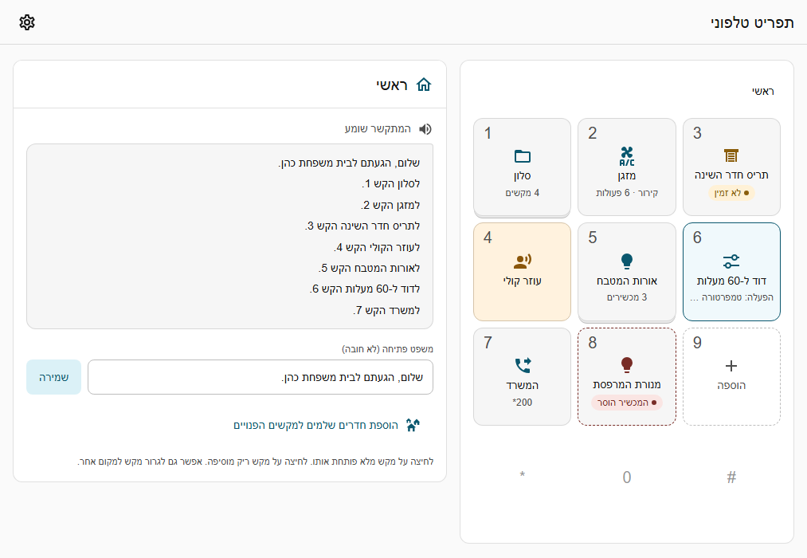
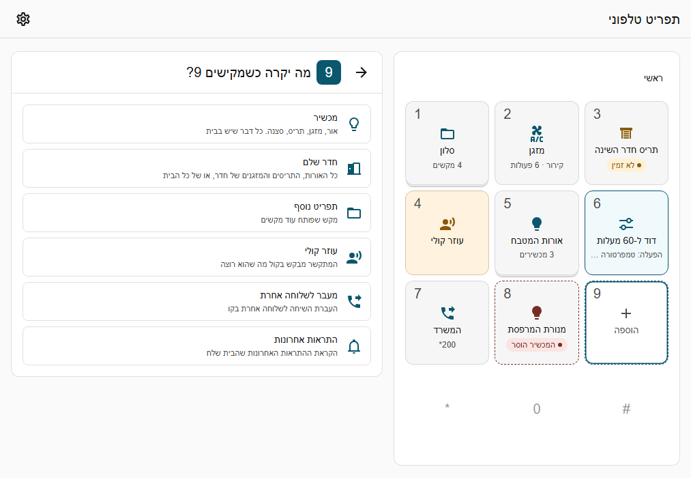
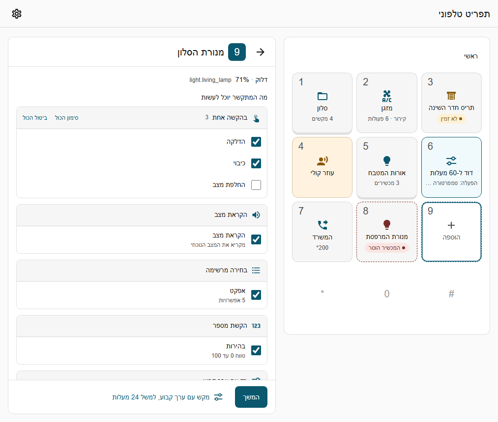
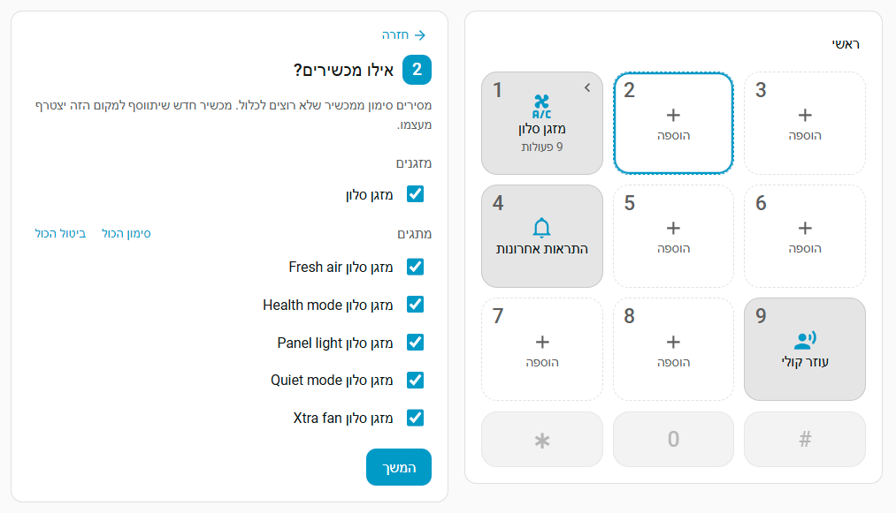
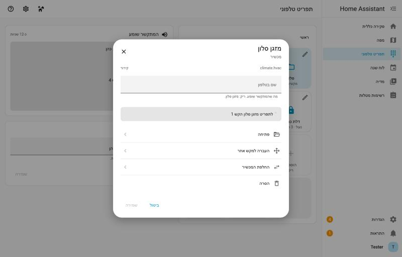
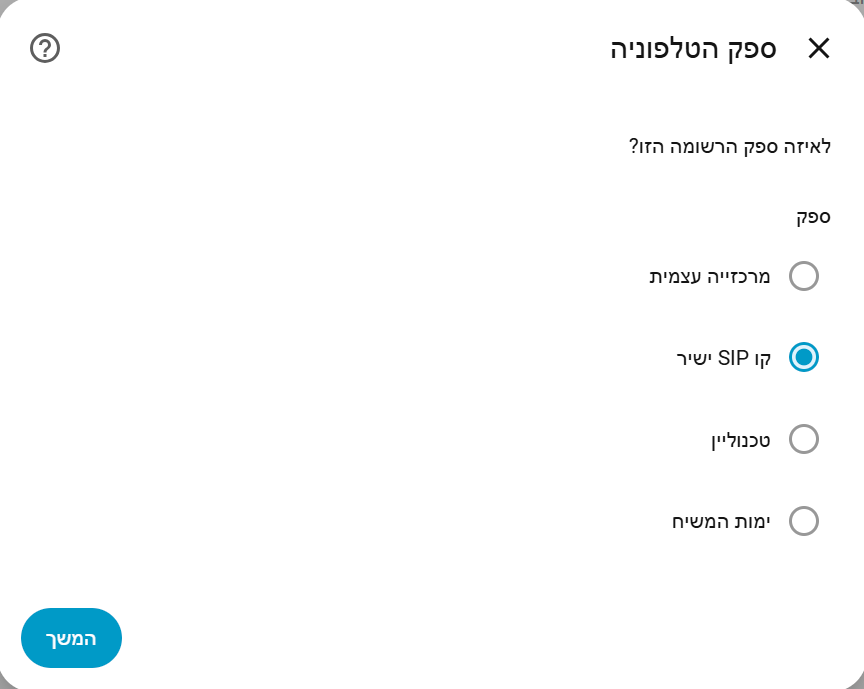
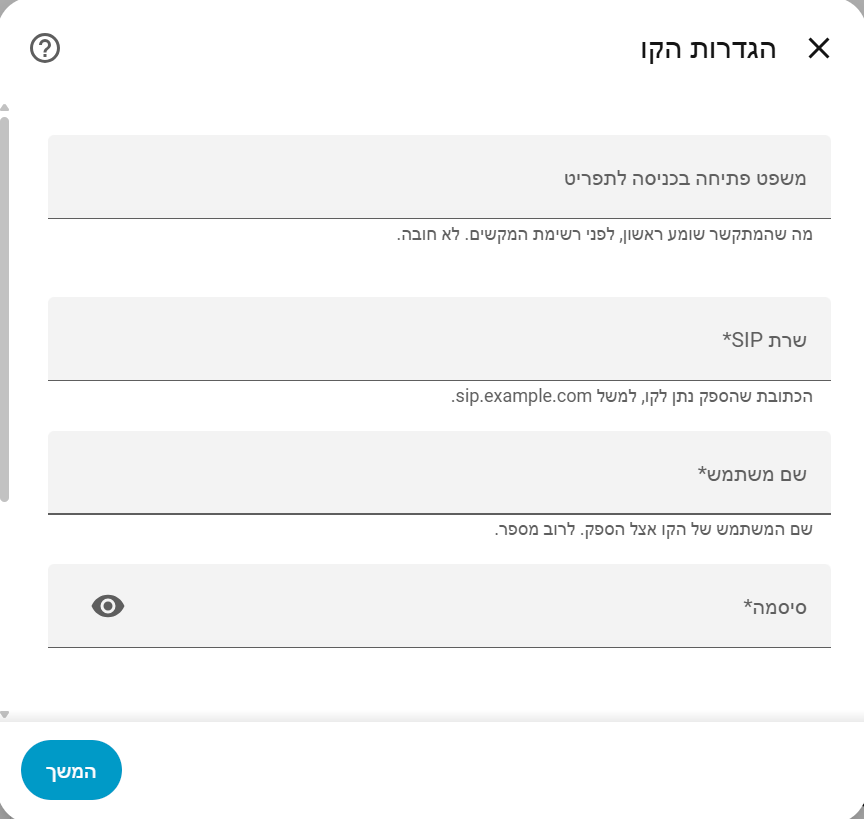
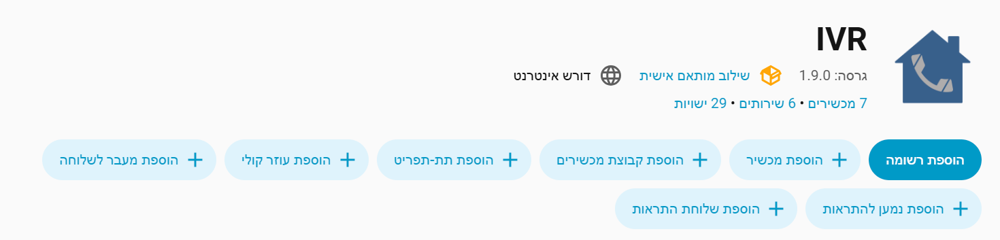
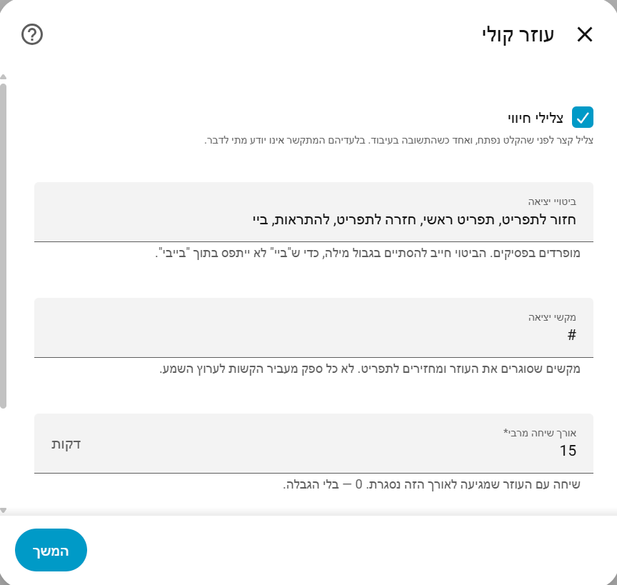

<div dir="rtl">

# IVR — תפריט טלפוני ועוזר קולי ל-Home Assistant

[](https://my.home-assistant.io/redirect/marketplace_repository/?owner=meni123&repository=ha-ivr&category=integration)
[](https://github.com/meni123/ha-ivr/actions/workflows/validate.yml)
[](https://www.home-assistant.io)
[](LICENSE)

> **English:** [README.en.md](README.en.md)

מתקשרים הביתה מטלפון רגיל. מקישים מקש כדי להדליק אור או לשמוע
מה מצב הדוד, או פשוט **מדברים** עם Home Assistant בשיחה חופשית.
ומקבלים התראות קוליות מהבית — שיחה שמצלצלת ומקריאה מה קרה.

בלי אינטרנט בטלפון, בלי אפליקציה, בלי VPN. **גם מטלפון כשר.**

---

## מה תקבלו, לפי הספק שלכם

| | ימות המשיח | טכנוליין | קו SIP ישיר | מרכזייה עצמית |
|---|:---:|:---:|:---:|:---:|
| **תפריט DTMF** — הקשה מפעילה ומקריאה | ✅ | ✅ | ✅ | ✅ |
| **עוזר קולי** — שיחה חופשית עם Assist | ❌ | ✅ | ✅ | ✅ |
| **התראות קוליות** — הבית מחייג אליכם | ✅ | ✅ | ✅ | ✅ |

הפער אינו עבודה חסרה — הוא מה שהספק מאפשר. לימות אין ערוץ
סטרימינג, ולכן אין דרך להזרים שיחה חיה.

**קו SIP ישיר** הוא הדרך הקצרה ביותר: מזינים שרת, שם משתמש וסיסמה
של קו SIP רגיל, ו-Home Assistant נרשם אליו בעצמו ועונה לשיחות. בלי
מרכזייה, בלי כתובת חיצונית, ובלי מה להגדיר אצל הספק. UDP ו-G.711,
בלי הצפנה.

**מרכזייה עצמית** היא מרכזיית Asterisk שרצה ברשת שלכם — בלי כתובת
חיצונית, בלי דומיין, בלי רישום מול ספק. העוזר הקולי עובד דרך
AudioSocket (PCM גולמי, בלי קודק). ראו [docs/pbx.md](docs/pbx.md)
לחוזה ולהגדרה, ואת המאגר הנלווה
[asterisk-ha-pbx](https://github.com/meni123/asterisk-ha-pbx) לבניית
השרת.

**אפשר להתקין כמה ספקים יחד.** כל אחד מקבל כרטיס משלו, עם תפריט,
טוקן וישויות נפרדים.

---

## איך זה נראה

**לוח המקשים** הוא עמוד בסרגל הצד של Home Assistant שמצייר לוח
מקשים של טלפון. כל מקש הוא מה שהמתקשר מקבל כשהוא מקיש עליו, ולצדו
מוצג מה שהוא שומע. הממשק בעברית או באנגלית, לפי שפת Home Assistant,
והמיקום בתפריט נשמר בכתובת: "אחורה" בדפדפן עולה רמה.

<p align="center">
  
</p>

לוחצים על מקש ריק ובוחרים מה יקרה בו. העורך נפתח בעמודה שליד הלוח,
ובטלפון — מלמטה:

<p align="center">
  
</p>

**מכשיר** — בוחרים מכשיר בחיפוש, כמו בבורר של Home Assistant: לפי
שם, מכשיר, מרחב או תווית. מסמנים מה המתקשר יוכל לעשות בו. כשיש
פעולה עם כמה ערכים, כמו מצב מיזוג או מהירות מאוורר, שלב נוסף שואל
אילו מהם להציע. מקש יכול גם לקבוע ערך מסוים: "מזגן ל-24", "אור
ל-30 אחוז".

<p align="center">
  
</p>

**חדר או אזור** — חדר, כמה חדרים יחד, קומה או תווית. בוחרים אילו
סוגי מכשירים ואילו מכשירים, ואז מה אפשר לעשות בכל סוג. "הוספה עם
הכול" מדלגת על הצעד האחרון. מוצעות רק פעולות שכל המכשירים תומכים בהן,
ומכשיר שמצטרף לחדר נכנס לתפריט מעצמו.

<p align="center">
  
</p>

מקש שנוצר נפתח בלחיצה, וכפתור ⋮ בפינה שלו פותח את העורך. שם משנים
שם וערך, ומהתפריט ⋮ מעבירים למקש או לתפריט אחר, מחליפים מכשיר
ומסירים. אחרי הסרה אפשר לבטל מההודעה שבתחתית:

<p align="center">
  
</p>

---

## דרישות מוקדמות

| הדרישה | הפירוט |
|---|---|
| Home Assistant | 2026.11 ומעלה |
| כתובת HTTPS חיצונית | הספק פונה **פנימה** אל השרת שלכם. מנהרת Cloudflare, Nginx, DuckDNS — כל פתרון. לא נדרשת בקו SIP ישיר ובמרכזייה עצמית |
| הצפנה | חובה. הטוקן עובר בתוך הכתובת |
| חשבון אצל ספק | ימות המשיח או טכנוליין — או קו SIP רגיל מכל ספק |
| לעוזר הקולי בלבד | צינור Assist מוגדר, עם זיהוי דיבור והקראה |

---

## התקנה — חמישה שלבים

### שלב 1 · התקנת האינטגרציה

**דרך ה-Marketplace של Home Assistant (מומלץ)**

1. לחצו [**כאן**](https://my.home-assistant.io/redirect/marketplace_repository/?owner=meni123&repository=ha-ivr&category=integration) — העמוד של IVR נפתח ב-Marketplace של ה-Home
   Assistant שלכם
2. הורידו את האינטגרציה. IVR אינו בקטלוג המובנה, ולכן ה-Marketplace
   מבקש חיבור ל-GitHub אם עוד לא חיברתם
3. **הפעילו מחדש את Home Assistant** — הפעלה מלאה, לא טעינת הגדרות

בלי הקישור: ב-Marketplace, `Custom repositories`, מדביקים
`https://github.com/meni123/ha-ivr` בקטגוריה `Integration`.

**ידנית**

העתיקו את התיקייה `custom_components/ha_ivr/` **במלואה**, כולל
`translations/` ו-`brand/`, אל `config/custom_components/`,
והפעילו מחדש.

---

### שלב 2 · הגדרת שרת מתווך

**נדרש כשהספק פונה אל השרת שלכם** — ימות המשיח וטכנוליין. בקו SIP
ישיר ובמרכזייה עצמית אפשר לדלג.

השרת שלכם אינו מחובר ישירות לאינטרנט אלא דרך שומר סף. בלי ההגדרה
הזו Home Assistant רואה את כתובת שומר הסף במקום את כתובת הספק,
**וחוסמת את הספק עצמו.** התסמין הוא שיחה שמתנתקת בלי אף שורה
ביומן.

*הגדרות ← מערכת ← רשת ← שרת HTTP*

יש לסמן **Trust X-Forwarded-For** ולהוסיף לרשימת המתווכים את
`127.0.0.1` ואת `::1`. שתי השורות הן אותה כתובת מקומית בשני
כתיבים, ושתיהן נדרשות. אם שומר הסף רץ על מכונה אחרת, הוסיפו את
כתובתה.

---

### שלב 3 · חיבור הספק

*הגדרות ← מכשירים ושירותים ← הוספת אינטגרציה ← **IVR***

<p align="center">
  
</p>

השלב הראשון שואל **איזה ספק**. כל מה שאחריו מציג את השדות שלו
בלבד — מי שבחר ימות לא יראה שדות של טכנוליין, ולא יראה מסך
"עוזר קולי", כי אין לו ערוץ סטרימינג.

| השדה | ההסבר |
|---|---|
| טווחי IP של הספק | מי מורשה לפנות. ברירת המחדל היא הטווח של הספק שנבחר |
| מספרי טלפון מורשים | מי מורשה להתקשר. אופציונלי, **ומומלץ מאוד** |
| משפט פתיחה | מה נשמע בכניסה לתפריט |
| שדה הזדהות | טוקן ניהול (ימות) או מפתח API (טכנוליין) — נדרש להתראות בלבד |

---

### שלב 4 · הגדרת השלוחה אצל הספק

מסך ההגדרות של הרשומה מציג את הכתובת המדויקת להעתקה. זה המקום
היחיד בממשק שמראה אותה:

<div dir="ltr">

```
https://<הכתובת שלכם>/api/ha_ivr/<ספק>/<הטוקן>
```

</div>

#### ימות המשיח

שלוחה מסוג `api`, ובה:

<div dir="ltr">

```ini
type=api
api_link=https://<הכתובת שלכם>/api/ha_ivr/yemot/<הטוקן>
api_url_post=yes
api_end_goto=hangup
```

</div>

| השדה | למה הוא נדרש |
|---|---|
| `api_link` | הכתובת מהמסך. **הטוקן הוא חלק מהנתיב** |
| `api_url_post` | הפרמטרים מגיעים בגוף הבקשה |
| `api_end_goto` | מכסה מקרה שבו התשובה אינה מציינת לאן להמשיך. ברירת המחדל של ימות היא לחזור שלב אחורה |

#### טכנוליין

**שתי שלוחות** — אחת לתפריט, ואחת לעוזר הקולי:

1. **שלוחה מסוג `api`** — הדביקו בה את הכתובת מהמסך. זה התפריט.
   יש לאפשר בה את **כל המקשים**: רשימה מצומצמת גורמת למרכזייה
   לבלוע מקש שאינו בה, וההקשה כלל לא מגיעה.

2. **שלוחה מסוג `stream`** — לעוזר הקולי בלבד. הדביקו בה את כתובת
   ה-`wss` מהמסך, **והוסיפו כותרת `Authorization`** בערך:

   <div dir="ltr">

   ```
   Bearer <הטוקן>
   ```

   </div>

   אותו טוקן שבכתובת. **בלי הכותרת הזו החיבור נדחה ב-401** והעוזר
   לא יענה.

#### קו SIP ישיר

**אין מה להגדיר אצל הספק.** השרת, שם המשתמש והסיסמה שהספק נתן לקו
מוזנים בהוספת הרשומה, ו-Home Assistant נרשם אליו בעצמו. פרטים
שגויים נעצרים כבר בטופס.

<p align="center">
  
</p>

אפשר להוסיף כמה קווים — רשומה לכל חשבון. לחשבון שכבר רשום במרכזייה
או בטלפון אחר צרו משתמש SIP נפרד: שתי הרשמות לאותו חשבון גונבות
שיחות זו מזו.

סיסמה שהספק דוחה אחר כך מופיעה בכרטיס האינטגרציה כבקשה להתחבר מחדש:
מזינים את הסיסמה הנוכחית, והיא נבדקת לפני השמירה. שרת או פורט שהשתנו
מתעדכנים ב"הגדרה מחדש" מאותו כרטיס.

---

### שלב 5 · בניית התפריט

**בלוח המקשים** — "תפריט טלפוני" בסרגל הצד. לוחצים על מקש ריק
ובוחרים מה יקרה בו, כמתואר ב[איך זה נראה](#איך-זה-נראה).

**או בכרטיס האינטגרציה**, בטפסים של Home Assistant. שם מוסיפים גם
נמענים להתראות:

<p align="center">
  
</p>

| הסוג | מה הוא עושה |
|---|---|
| **מכשיר** | מכשיר אחד: תפריט משלו עם כל מה שהוא יודע לעשות, או פעולה אחת בהקשה |
| **קבוצת מכשירים** | כמה מכשירים במקום שבוחרים: פריט אחד לסוג אחד, תת-תפריט לכמה סוגים |
| **תת-תפריט** | מקש שפותח רמה נוספת. מקנן עד ארבע רמות; הזזה שלו מעבירה גם את מה שתחתיו |
| **עוזר קולי** | מקש שמחבר את המתקשר לעוזר הקולי |
| **מעבר לשלוחה** | מוסר את השיחה לשלוחה אחרת אצל הספק |
| **שלוחת התראות** | מקריאה למתקשר את ההתראות שנשלחו אליו |
| **נמען להתראות** | מספר טלפון שהופך לישות `notify`. אינו חלק מהתפריט |

> **בשורה אחת:** מכשיר אחד ⇐ מכשיר · כמה מכשירים יחד ⇐ קבוצת מכשירים.

#### תפריט משלו או פעולה אחת

**תפריט משלו** — מכשיר עם הרבה אפשרויות. במזגן: הדלקה, כיבוי,
מצבי מיזוג ומאוורר, והקשת מספר למעלות. הכול בבחירה אחת.

**פעולה אחת** — כשהמקש צריך לעשות דבר אחד מיד, או כשצריך **ערך
משלכם**: "הוסף חלב לרשימת הקניות", "שלח הודעה מסוימת". תפריט
שנבנה לבד אינו יכול למלא שדה טקסט או ערך חופשי.

הנתיב הוא רצף המקשים: `1` הוא מקש 1 בשורש, `1/2` הוא מקש 2 בתוך
תת-התפריט של מקש 1. `*` חוזר רמה אחורה.

**העץ נבנה מחדש בכל שיחה**, ולכן שינוי משפיע על השיחה הבאה — בלי
הפעלה מחדש.

---

## העוזר הקולי

<p align="center">
  
</p>

ערוץ WebSocket מזרים אודיו דו-כיווני אל צינור Assist. שיחה
חופשית בטלפון, כולל שליטה במכשירים, קטיעה באמצע דיבור, וביטוי
יציאה שמחזיר לתפריט.

רץ כישות `assist_satellite` — אותה פלטפורמה שבה משתמשת
אינטגרציית ה-VoIP של Home Assistant עצמה.

**הצינור ורגישות ה-VAD הם ישויות `select` על המכשיר, ולא שדות
בטופס.** זו אינה בחירת סגנון: Home Assistant קוראת את שניהם
ממרשם הישויות, וערך שנקבע במקום אחר פשוט לא יגיע לצינור.

**שני קווים לכל רשומה.** שיחה שנייה במקביל נוחתת על הקו השני;
שלישית נדחית בצליל, ולא בסוקט שנסגר בשקט.

---

## התראות קוליות

כל נמען הוא ישות `notify` נפרדת, ולכן אוטומציה בוחרת אנשים בדיוק
כמו שהיא בוחרת כל ישות אחרת:

<div dir="ltr">

```yaml
automation:
  - alias: front_door_alert
    triggers:
      - trigger: state
        entity_id: binary_sensor.front_door
        to: "on"
    actions:
      - action: notify.send_message
        target:
          entity_id: notify.aba
        data:
          message: דלת הכניסה נפתחה
```

</div>

למספר שמחושב בזמן ריצה — מתבנית, מ-`person`, או מכל מקום אחר —
יש `ha_ivr.send_call` שמקבל רשימה מפורשת.

בכל שיחה נכנסת נורה גם האירוע `ha_ivr_call_received`, ובו הנתיב,
המכשיר והמתקשר. אפשר להפעיל אוטומציה על השיחה עצמה.

**בטכנוליין ההקראה נוצרת ב-Home Assistant** ולא אצל הספק: השיחה
היוצאת רק מחייגת ומחברת את הנמען לערוץ הסטרימינג. זו גם העקיפה
של מנוע ההקראה שלהם, שנכשל בחלק מהחשבונות.

### ערוצי התראה בימות — חוסכים כסף

שיחה קולית יוצאת עולה **יחידה מלאה** אצל ימות. לכן בכרטיס הנמען
אפשר לבחור ערוץ זול יותר:

| הערוץ | העלות | מה הנמען מקבל |
|---|---|---|
| **שיחה קולית** | יחידה | שיחה שמקריאה את ההתראה |
| **SMS** | **עשירית יחידה** | הודעת טקסט עם ההתראה |
| **צינתוק** | **עשירית יחידה** | צלצול קצר, בלי תוכן |

**SMS זול פי-עשרה** ונושא את אותו מידע — להתראת בית טיפוסית זה
שתי אגורות במקום עשרים. הערכים נמדדו מול המחירון של ימות.

### צינתוק כמערכת התראות מלאה

הצינתוק זול פי-עשרה, אבל אין בו תוכן. השילוב עם שלוחת **"התראות
אחרונות"** הופך אותו למערכת שלמה, שכל עלותה עשירית יחידה:

1. חיישן נדלק → נשלח **צינתוק** לנמען (עשירית יחידה)
2. הנמען רואה שיחה שלא נענתה, ומתקשר **פנימה** למערכת
3. בכניסה לתפריט הוא שומע *"יש לך התראה חדשה"*
4. הוא מקיש על שלוחת "התראות אחרונות" — ושומע מה קרה

התוכן נמסר בשיחה **נכנסת**, ולכן נחסך החיוב על שיחה יוצאת. **כל
מתקשר שומע רק את ההתראות שנשלחו אליו** — לפי מספרו, בלי שיתערבבו
בין אנשים.

את שלוחת "התראות אחרונות" מוסיפים מכפתור ה-`+` בכרטיס האינטגרציה,
כמו כל פריט אחר. כל התראה שנשלחת — בכל ערוץ — נרשמת ונקראת שם.

---

## אבטחה

**האינטגרציה פותחת נקודת גישה אינטרנטית שיכולה לשלוט פיזית בבית,
כולל תריסים ומנעולים.** קראו את הפרק הזה לפני שמפעילים.

### מה מובנה

- סינון לפי כתובת החיבור האמיתית, עמיד בפני זיוף כותרות
- טוקן אקראי חזק, בהשוואת זמן קבוע כהגנה מפני התקפת תזמון
- אימות `Bearer` נדרש בערוץ הסטרימינג — בטכנוליין מגדירים אותו
  בשלוחה
- הטוקן מזהה את **הרשומה** — בקשה לספק אחד לא תיפתר מול טוקן של אחר
- רשימת היתר לפעולות, הנבדקת לפני כל שלב אחר
- סינון לפי מספר המתקשר — שכבת ההגנה החזקה ביותר
- תקרת קווים ותקרת אורך שיחה, כחסם מול ניצול
- סודות מוסתרים ביומן, בהיסטוריה ובקובץ האבחון, וכך גם טלפונים
  וכתובות SIP בתוך טקסט חופשי
- קוד של מנעול או אזעקה מוקש בשיחה ואינו נשמר בשום מקום. שלוש
  דחיות בשיחה נועלות את פעולות הקוד עד סופה; ניחוש חוזר ממספר אחד,
  או מכמה מספרים יחד, חוסם אותן לרבע שעה

### הטוקן הוא סיסמה לכל דבר

הוא מוטמע בתוך הכתובת שמוגדרת אצל הספק. **אין לפרסם אותה** —
לא בפורומים, לא בקבוצות תמיכה, לא בצילומי מסך ולא בדוחות תקלה.
בכל חשד לדליפה יש להחליף את הטוקן במסך ההגדרות ולעדכן אצל הספק.

### סיכונים שכדאי להכיר

| הסיכון | ההמלצה |
|---|---|
| שליטה במנעולים ובשערים | מלאו את שדה מספרי הטלפון המורשים |
| **עלויות טלפוניה** | כל שיחה נכנסת ויוצאת עולה כסף אצל הספק |
| **עלויות עוזר קולי** | כל שיחה צורכת זיהוי דיבור, מודל שפה והקראה — לרוב בתשלום לפי שימוש |
| טוקן שדלף | מי שמחזיק בו יכול לפתוח שיחות ולשרוף תקציב, גם בלי לגעת בבית |
| ביטול סינון הכתובות | רק לאבחון, ולזמן קצר |
| עבודה בלי הצפנה | הטוקן עובר בטקסט גלוי |
| רשימת מתווכים רחבה מדי | רשמו רק את שומרי הסף שהפעלתם בעצמכם |

### הפעלת החסימה האוטומטית

מנגנון מובנה של Home Assistant, כבוי כברירת מחדל:

<div dir="ltr">

```yaml
http:
  ip_ban_enabled: true
  login_attempts_threshold: 10
```

</div>

שימו לב שכישלון חוזר בהזנת הסיסמה שלכם עלול לנעול אתכם מחוץ
למערכת. השחרור מחייב עריכת קובץ החסימות והפעלה מחדש.

---

## פתרון תקלות

**בקשה שהגיעה תמיד מייצרת שורה ביומן, גם כשהיא נדחית.** לכן יומן
ריק לגמרי פירושו שהבקשה **מעולם לא הגיעה** — הבעיה אצל הספק או
בכתובת, לא כאן.

| התסמין | הסיבה האפשרית |
|---|---|
| השיחה מתנתקת מיד, **אפס שורות ביומן** | הכתובת אצל הספק שגויה או מגרסה קודמת |
| ביומן `Blocked a request from…` | חסרה הגדרת השרת המתווך (שלב 2), או שהטווח שגוי |
| ביומן `Bad token` / `401` | הטוקן שבכתובת אצל הספק אינו תואם. העתיקו מחדש |
| ביומן `503 Not configured` | לא הוגדרה רשומה לספק הזה |
| הקשה על מקש לא מוגדר — שקט מוחלט | הגדרת המרכזייה מגבילה את המקשים. יש לאפשר את כולם |
| הממשק מוצג באנגלית | תיקיית `translations` לא הועתקה, או שנדרשת הפעלה מלאה |
| העוזר הקולי אינו עונה | בטכנוליין: חסרה שלוחת `stream`, או שכותרת ה-`Authorization` אינה מוגדרת בה |
| ההתראה נכשלת | בדקו את יתרת היחידות אצל הספק — זו הסיבה השכיחה |

לאבחון מפורט:

<div dir="ltr">

```yaml
logger:
  logs:
    custom_components.ha_ivr: debug
```

</div>

בכרטיס האינטגרציה יש גם **הורדת אבחון** — קובץ אחד עם ההגדרות
(בלי סודות), עץ התפריטים כפי שנבנה בפועל, והחליפין האחרונים מול
הספק. זה מה שכדאי לצרף לדיווח תקלה.

---

## מגבלות ידועות

הפרויקט נבנה מול מדידה בשיחות אמיתיות, ולא מול תיעוד. מה שלא
אומת מסומן ככזה, כאן וב-`CHANGELOG.md`:

- **שדות 7–10 ב-`read` של ימות** — המיפוי אינו מאושר, והקוד במכוון
  אינו מנחש אותו
- **VAD שלעיתים מפספס תחילת דיבור** — נחקר, לא נפתר

---

## הצהרת אחריות

**התוסף מסופק כמות שהוא, ללא כל אחריות מכל סוג שהוא. השימוש בו
הוא באחריותו הבלעדית והמלאה של המשתמש.**

המפתח אינו נושא באחריות כלשהי, ישירה או עקיפה, לכל נזק, אובדן,
פריצה, גישה בלתי מורשית, תקלה, הפעלה שגויה של מכשירים, חיוב
כספי, או כל תוצאה אחרת הנובעת מהתקנת התוסף, מהשימוש בו, או מאי
היכולת להשתמש בו.

בפרט, ומבלי לגרוע מן האמור לעיל:

- התוסף פותח נקודת גישה אינטרנטית לשליטה במכשירים פיזיים. **הערכת
  הסיכון וההחלטה להתקין הן באחריות המשתמש בלבד**
- אמצעי האבטחה נועדו להקטין סיכון, ואינם מבטיחים הגנה מוחלטת
  מפני גישה בלתי מורשית
- שילוב עם מנעולים, שערים או מערכות אזעקה נעשה על אחריות המשתמש
  בלבד
- **כל העלויות הן באחריות המשתמש** — שיחות נכנסות ויוצאות אצל
  ספק הטלפוניה, וכן זיהוי דיבור, מודל שפה והקראה בעוזר הקולי,
  שלרוב מחויבים לפי שימוש
- המשתמש אחראי לאבטחת השרת שלו, לשמירת סודיות הטוקן, ולתצורת
  שומר הסף שלו
- **התוסף אינו מוצר רשמי של Home Assistant**, אינו מפותח, נתמך או
  מאושר בידי Open Home Foundation או Nabu Casa, והמפתח אינו קשור
  אליהן. זהו שילוב מותאם אישית של צד שלישי
- **התוסף אינו מוצר רשמי של ימות המשיח או טכנוליין**, אינו נתמך
  ואינו מאושר על ידן, והמפתח אינו קשור לאף אחת מהן
- המשתמש אחראי לעמידה בתנאי השימוש של הספק שבחר

**התקנת התוסף והשימוש בו מהווים הסכמה מלאה לתנאים אלה.**

---

## פיתוח

<div dir="ltr">

```bash
python3 tests/run_live.py     # 350 בדיקות, בלי Home Assistant
python3 tests/check_names.py  # שם שנקרא לפני שהוגדר
python3 tests/check_flow.py   # שימוש לפני השמה
python3 tests/check_gate.py   # כל מסלול יציאה פותח את שער הקלט
```

</div>

הבדיקות מייבאות את המודולים האמיתיים מול Home Assistant מזויף,
ולכן שינוי חתימה או ייבוא חסר נופלים כאן ולא בשיחה. חלקן אוכפות
כללים ארכיטקטוניים: הליבה אינה רשאית לנקוב בשם ספק, כל שגיאה
שמוצגת למשתמש נושאת מפתח תרגום, ואף מספר טלפון אמיתי או נתיב
אישי אינו נכנס לעץ.

**הוספת ספק** היא מודול חדש ב-`providers/` ושורה אחת ב-`PROVIDERS`.
יש בדיקה שנכשלת אם נדרש משהו מעבר לזה.

---

## הקודם לו

הפרויקט ממשיך את [`ha-yemot`](https://github.com/meni123/ha-yemot),
שתמך בימות בלבד. אפשר להתקין את שניהם זה לצד זה — רק לא על אותה
שלוחה.

## רישיון

[MIT](LICENSE), הכולל את סעיף היעדר האחריות הסטנדרטי שלו.

</div>
